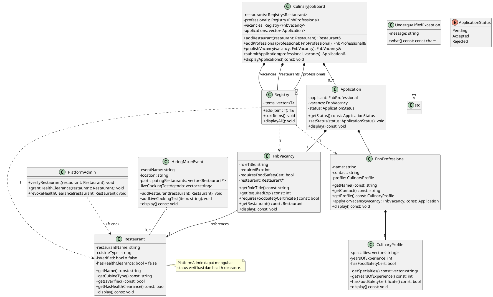

# Panduan UML F&B Jobs Center

Setiap kelas berada di file `.cpp` terpisah tanpa file `.hpp`. `main.cpp`
meng-include file kelas tersebut untuk menyediakan definisinya saat kompilasi.
Dokumen ini menjadi panduan untuk menggambar class diagram sistem pusat
lowongan kerja kuliner dan restoran.

## Langkah menggambar

1. Buat kotak untuk setiap kelas: `UnderqualifiedException`,
   `CulinaryProfile`, `FnbProfessional`, `Restaurant`, `FnbVacancy`,
   `Application`, `HiringMixerEvent`, `PlatformAdmin`, `Registry<T>`, dan
   `CulinaryJobBoard`.
2. Bagi kotak kelas menjadi nama, atribut, dan operasi. Gunakan `-` untuk
   `private` dan `+` untuk `public`.
3. Hubungkan kelas menggunakan relasi UML:
   - `FnbProfessional` memiliki `CulinaryProfile` (composition, belah ketupat
     hitam di sisi `FnbProfessional`).
   - `Application` menyimpan satu `FnbProfessional` dan satu `FnbVacancy`.
   - `FnbVacancy` merujuk ke satu `Restaurant`.
   - `HiringMixerEvent` menyimpan kumpulan restoran peserta.
   - `CulinaryJobBoard` mengelola registry restoran, profesional, lowongan,
     serta kumpulan lamaran.
   - `PlatformAdmin` memiliki dependency `<<friend>>` terhadap `Restaurant`.
   - `UnderqualifiedException` mewarisi `std::exception`.
   - `Registry<T>` adalah template yang menyimpan dan mengurutkan entitas.
4. Tempelkan PlantUML di bawah ke editor PlantUML atau gunakan relasinya untuk
   menggambar diagram secara manual di draw.io.

## PlantUML

## Catatan implementasi

- `FnbProfessional` memiliki `CulinaryProfile` sebagai composition.
- Pembuatan lowongan mensyaratkan restoran sudah terverifikasi dan memiliki
  health clearance.
- Pelamar ditolak dengan `UnderqualifiedException` ketika pengalaman tidak
  cukup atau sertifikat keamanan pangan diwajibkan tetapi tidak dimiliki.
- `Registry<FnbVacancy>` mengurutkan lowongan berdasarkan pengalaman minimum.
- Tambahkan semua restoran ke registry sebelum membuat lowongan atau event yang
  menyimpan pointer ke restoran, agar alamat objek tetap valid.
